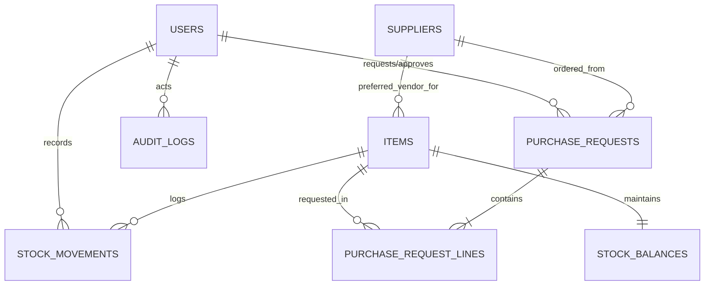

# LabStock Database Schema & Design

## 1. Relational Entity Overview
LabStock uses a normalized relational architecture designed for SQLite (with WAL mode enabled) and fully portable to PostgreSQL. All foreign keys enforce referential integrity (`PRAGMA foreign_keys = ON`).

## 2. Table Specifications

### 2.1 `users`
Stores user identities, hashed credentials, and role authorizations.
| Column | Type | Constraints | Description |
|---|---|---|---|
| `id` | INTEGER | PRIMARY KEY | Internal user identifier |
| `email` | VARCHAR(255) | UNIQUE, NOT NULL, INDEX | Login email address |
| `full_name` | VARCHAR(255) | NOT NULL | User's legal or institutional name |
| `password_hash` | VARCHAR(255) | NOT NULL | Argon2id password hash |
| `role` | VARCHAR(50) | NOT NULL, DEFAULT 'viewer' | RBAC: `administrator`, `inventory_manager`, `viewer` |
| `is_active` | BOOLEAN | NOT NULL, DEFAULT TRUE | Soft deactivation flag |
| `last_login_at` | DATETIME | NULLABLE | Timestamp of most recent authenticated session |
| `created_at` | DATETIME | NOT NULL | Record creation timestamp |
| `updated_at` | DATETIME | NOT NULL | Last modification timestamp |

### 2.2 `items`
Catalog of laboratory spare parts, components, sensors, and consumables.
| Column | Type | Constraints | Description |
|---|---|---|---|
| `id` | INTEGER | PRIMARY KEY | Internal item identifier |
| `sku` | VARCHAR(100) | UNIQUE, NOT NULL, INDEX | Institutional Stock Keeping Unit code |
| `name` | VARCHAR(255) | NOT NULL, INDEX | Human-readable part name |
| `description` | TEXT | NULLABLE | Detailed technical specifications |
| `category` | VARCHAR(100) | NOT NULL, INDEX | E.g., Microcontrollers, Motors, Passives |
| `unit` | VARCHAR(50) | NOT NULL, DEFAULT 'pcs' | Measurement unit (pcs, reels, meters, etc.) |
| `storage_location` | VARCHAR(100) | NOT NULL, INDEX | Storage bin, aisle, or rack (e.g. `BIN-B2-04`) |
| `min_stock_threshold` | FLOAT | NOT NULL, DEFAULT 0.0 | Replenishment trigger threshold |
| `target_stock` | FLOAT | NULLABLE | Desired reorder equilibrium target |
| `unit_cost` | FLOAT | NULLABLE | Nominal unit acquisition cost |
| `supplier_id` | INTEGER | FOREIGN KEY (`suppliers.id`), NULLABLE | Primary vendor reference |
| `is_active` | BOOLEAN | NOT NULL, DEFAULT TRUE | Catalog visibility status |
| `created_at` | DATETIME | NOT NULL | Creation timestamp |
| `updated_at` | DATETIME | NOT NULL | Last modification timestamp |

### 2.3 `stock_balances`
Real-time snapshot table of item balances, constrained against negative stock.
| Column | Type | Constraints | Description |
|---|---|---|---|
| `id` | INTEGER | PRIMARY KEY | Balance row identifier |
| `item_id` | INTEGER | FOREIGN KEY (`items.id`), UNIQUE, NOT NULL | Linked item catalog reference |
| `quantity_on_hand` | FLOAT | NOT NULL, DEFAULT 0.0, CHECK(`>= 0`) | Physical pieces in storage |
| `reserved_quantity` | FLOAT | NOT NULL, DEFAULT 0.0, CHECK(`>= 0`) | Allocated to pending projects |
| `available_to_issue` | FLOAT | NOT NULL, DEFAULT 0.0, CHECK(`>= 0`) | Unreserved allocatable quantity |
| `last_counted_at` | DATETIME | NULLABLE | Physical count verification date |
| `last_movement_at` | DATETIME | NULLABLE | Timestamp of last transaction |
| `updated_at` | DATETIME | NOT NULL | Balance mutation timestamp |

### 2.4 `stock_movements`
Immutable double-entry ledger recording all physical stock adjustments.
| Column | Type | Constraints | Description |
|---|---|---|---|
| `id` | INTEGER | PRIMARY KEY | Ledger transaction index |
| `item_id` | INTEGER | FOREIGN KEY (`items.id`), NOT NULL, INDEX | Item being adjusted |
| `movement_type` | VARCHAR(50) | NOT NULL, INDEX | `RECEIPT`, `ISSUE`, `RETURN`, `DAMAGE`, `ADJUSTMENT`, `REVERSAL` |
| `quantity` | FLOAT | NOT NULL | Absolute positive quantity entered |
| `signed_quantity` | FLOAT | NOT NULL | Mathematical delta applied to balance (+ or -) |
| `balance_after` | FLOAT | NOT NULL | Item balance on hand post-transaction |
| `reference_type` | VARCHAR(50) | NULLABLE | E.g., `PURCHASE_ORDER`, `LAB_PROJECT`, `DAMAGE_REPORT` |
| `reference_id` | VARCHAR(100) | NULLABLE | Document ID / PO number |
| `notes` | TEXT | NULLABLE | Operator explanation or context |
| `idempotency_key` | VARCHAR(100) | UNIQUE, NULLABLE | Replay deduplication key |
| `actor_id` | INTEGER | FOREIGN KEY (`users.id`), NULLABLE | User who executed transaction |
| `created_at` | DATETIME | NOT NULL, INDEX | Ledger transaction timestamp |

### 2.5 `suppliers`
Vendor and manufacturer profiles for parts procurement.
| Column | Type | Constraints | Description |
|---|---|---|---|
| `id` | INTEGER | PRIMARY KEY | Supplier identifier |
| `name` | VARCHAR(255) | NOT NULL, INDEX | Vendor company name |
| `contact_person` | VARCHAR(255) | NULLABLE | Account manager or representative |
| `email` | VARCHAR(255) | NULLABLE | Order dispatch email |
| `phone` | VARCHAR(100) | NULLABLE | Contact phone number |
| `address` | TEXT | NULLABLE | Physical headquarters / dispatch address |
| `is_active` | BOOLEAN | NOT NULL, DEFAULT TRUE | Active vendor status |
| `created_at` | DATETIME | NOT NULL | Vendor registration date |
| `updated_at` | DATETIME | NOT NULL | Last update date |

### 2.6 `purchase_requests` & `purchase_request_lines`
Procurement cycle tracking from draft to institutional goods receipt.
- `purchase_requests`: Tracks `request_number` (e.g. `PR-2026-0001`), `status` (`draft`, `submitted`, `approved`, `ordered`, `partially_received`, `received`, `cancelled`), `supplier_id`, `requester_id`, `approver_id`, `approved_at`, `notes`.
- `purchase_request_lines`: Contains requested items, `quantity_requested`, `quantity_received`, and `unit_price`.

### 2.7 `audit_logs`
System security and administrative audit trail recording security actions, role changes, and system modifications.
